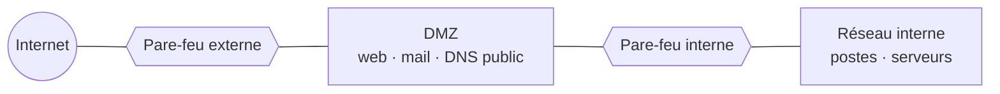

[Sommaire](Readme.md) · [Chapitre suivant →](02-Matrices-de-flux-et-regles.md)

# Le pare-feu

## 🎯 Objectifs du chapitre

- Définir un pare-feu et ses différents types
- Citer les principaux constructeurs
- Comprendre le découpage d'un réseau en zones et le rôle de la DMZ

---

## 1. Définition

Un **pare-feu** (*firewall*) est un dispositif de sécurité qui contrôle et
filtre les connexions réseau **entrantes et sortantes** d'un système
informatique. Il surveille, contrôle, puis **autorise ou bloque** les flux de
données et d'applications, selon les types de communications autorisées.

### Les types de pare-feu

| Type | Description |
|---|---|
| **Matériel** | Équipement dédié, placé entre le réseau interne et le réseau externe pour en contrôler le trafic |
| **Logiciel** | Logiciel installé sur un poste ou un serveur, qui filtre les connexions de cette seule machine |
| **Virtuel** | Logiciel installé sur un système socle (souvent une VM), placé entre deux réseaux : l'équivalent virtuel du pare-feu matériel |
| **NGFW** — *Next Generation Firewall* | Pare-feu qui intègre le filtrage de contenu et l'inspection approfondie des paquets |
| **ALG** — *Application Layer Gateway* | Pare-feu doté de modules d'analyse propres à certains protocoles applicatifs : FTP, SIP, H.323… |
| **Cloud** | Pare-feu hébergé dans le cloud, qui filtre le trafic avant qu'il n'atteigne l'infrastructure |

### Le pare-feu physique

Les pare-feu physiques sont généralement vendus sous forme de **boîtier
tout-en-un** (*appliance*), qui réunit le matériel et le logiciel.

---

## 2. Les principaux constructeurs

| Commerciaux | Open source |
|---|---|
| Cisco, Fortinet, Palo Alto Networks, Check Point, Juniper Networks, SonicWall, WatchGuard, Sophos, Stormshield | pfSense, OPNsense, IPFire |

---

## 3. Zones de pare-feu et DMZ

### Les zones

Une **zone de pare-feu** est une portion du réseau à laquelle on attribue un
niveau de sécurité : WAN, réseau de datacenter, LAN, DMZ… Découper le réseau
en zones permet de protéger les ressources importantes en contrôlant chaque
passage d'une zone à l'autre.

### La DMZ

Une **DMZ** (*zone démilitarisée*) héberge les serveurs qui doivent être
**accessibles depuis Internet** — serveurs web, de messagerie, DNS, FTP… —
tout en protégeant le réseau interne.

- Les serveurs de la DMZ sont joignables depuis Internet.
- Ils n'ont **pas d'accès direct** au réseau interne : ils ne communiquent
  qu'avec les systèmes autorisés, via des règles de pare-feu spécifiques.
- Si l'un d'eux est compromis, l'attaquant reste enfermé dans la DMZ.

> 💡 L'architecture à deux pare-feu ci-dessus est la plus robuste. On
> rencontre aussi souvent un **pare-feu unique à trois pattes** (WAN, DMZ,
> LAN), plus économique.

---

## ✅ Vérifier ses acquis

1. Quelle est la différence entre un pare-feu logiciel et un pare-feu virtuel ?
2. Pourquoi les serveurs de la DMZ ne doivent-ils pas accéder librement au LAN ?
3. Citez deux pare-feu open source.

Voir la correction

1. Le pare-feu logiciel protège la seule machine sur laquelle il est installé ; le pare-feu virtuel est placé entre deux réseaux et en filtre le trafic, comme un pare-feu matériel.
2. Ils sont exposés à Internet, donc les plus susceptibles d'être compromis : un accès libre au LAN offrirait un rebond à l'attaquant.
3. Au choix : pfSense, OPNsense, IPFire.

---

[Sommaire](Readme.md) · [Chapitre suivant →](02-Matrices-de-flux-et-regles.md)
