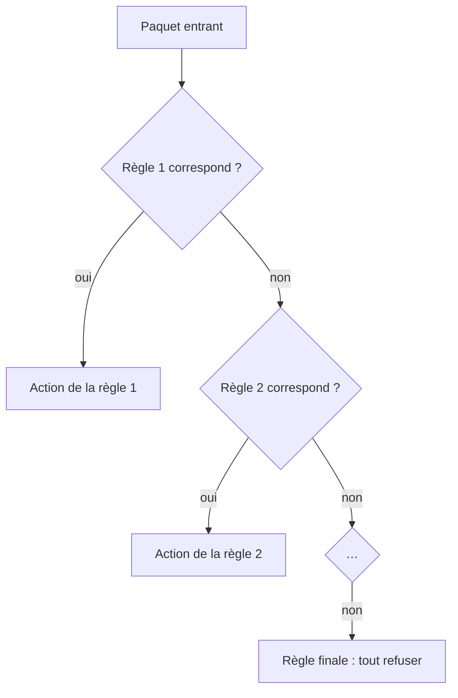

[← Chapitre précédent](01-Le-pare-feu.md) · [Sommaire](Readme.md) · [Chapitre suivant →](03-NAT.md)

# Matrices de flux et règles de filtrage

## 🎯 Objectifs du chapitre

- Lire et construire une matrice de flux
- Connaître les critères qui composent une règle de pare-feu
- Distinguer les types de règles

---

## 1. La matrice de flux

### Définition

Une **matrice de flux** (ou matrice de connectivité) recense les connexions
réseau entre les composants d'un système d'information — ordinateurs,
serveurs, routeurs, pare-feu… — et indique, pour chacune, si le flux est
**autorisé ou bloqué**.

Elle se présente sous forme de tableau : les sources en lignes, les
destinations en colonnes. Ses cases peuvent découler de règles de pare-feu,
de configurations de commutateurs ou de routeurs, ou de politiques de
sécurité.

Son analyse permet de :

- visualiser rapidement les flux autorisés et bloqués ;
- détecter les anomalies et les violations de la politique de sécurité ;
- optimiser la configuration, pour la sécurité comme pour les performances.

### Exemple

Ligne : zone source (**FROM**) · colonne : zone de destination (**TO**).

| FROM ＼ TO | WAN | SERVEURS | LAN | DMZ |
|---|---|---|---|---|
| **WAN** | — | aucun | OpenVPN | HTTP, HTTPS, SMTP |
| **SERVEURS** | DNS, HTTP, HTTPS | tous | aucun | aucun |
| **LAN** | tous | DNS, LDAP, SSH, DHCP, RDP, SMTP, IMAP, POP3 | tous | HTTP, HTTPS, SSH, RDP |
| **DMZ** | DNS, HTTP, HTTPS, SMTP | aucun | aucun | tous |

> 💡 Une matrice de flux se rédige **avant** de toucher au pare-feu : c'est
> le cahier des charges des règles. Tout flux absent de la matrice est
> interdit.

---

## 2. Les règles de filtrage

### Définition

Les **règles de pare-feu** sont les directives qui déterminent quel trafic est
autorisé ou interdit, selon différents critères.

### Les critères d'une règle

| Critère | Signification |
|---|---|
| **Adresse IP source** | machine ou réseau d'où provient le trafic |
| **Adresse IP de destination** | machine ou réseau qui doit le recevoir |
| **Protocole** | TCP, UDP, ICMP… |
| **Port source** | port utilisé par la machine source |
| **Port de destination** | port du service visé (443 pour HTTPS, 22 pour SSH…) |
| **Action** | autoriser, refuser (avec réponse), ignorer (sans réponse) |
| **Priorité** | position de la règle dans la liste |

D'autres critères s'y ajoutent souvent : sens du trafic (entrant, sortant),
plage horaire de validité, interface… Plus une règle est précise, plus elle
est efficace.

### L'ordre d'évaluation

Les règles sont évaluées **de haut en bas** ; la première qui correspond
s'applique, et l'évaluation s'arrête. Une politique saine se termine par une
règle « tout refuser ».

### Exemple de règles

| # | Source | Destination | Protocole | Port dst | Action |
|---|---|---|---|---|---|
| 1 | LAN | DMZ-web | TCP | 443 | autoriser |
| 2 | WAN | DMZ-web | TCP | 80, 443 | autoriser |
| 3 | DMZ | LAN | tous | tous | refuser |
| 4 | tous | tous | tous | tous | refuser |

### Les types de règles

| Type | Rôle |
|---|---|
| **Blocage** | bloquer un trafic, entrant ou sortant |
| **Autorisation** | autoriser un trafic, entrant ou sortant |
| **Redirection** | rediriger le trafic vers une autre adresse ou un autre port — vers un serveur web ou de messagerie, par exemple |
| **Traduction d'adresse (NAT)** | modifier l'adresse source ou de destination des paquets — voir le [chapitre 03](03-NAT.md) |
| **Détection d'intrusion (IDS)** | repérer les tentatives d'intrusion d'après des signatures ou des comportements — voir le [chapitre 04](04-Inspection-IDS-IPS.md) |
| **Filtrage d'URL** | filtrer le trafic HTTP/HTTPS selon les URL, domaines ou mots-clés |

> ⚠️ Une règle mal conçue ouvre une faille ou coupe un service. Chaque règle
> doit être pensée, évaluée, et documentée.

---

## ✅ Exercice

Une entreprise expose un site web en DMZ. Les postes du LAN doivent pouvoir
le consulter et l'administrer en SSH ; Internet ne doit pouvoir que le
consulter. Écrivez les règles.

Voir la correction

| # | Source | Destination | Protocole | Port dst | Action |
|---|---|---|---|---|---|
| 1 | LAN | serveur web (DMZ) | TCP | 80, 443 | autoriser |
| 2 | LAN | serveur web (DMZ) | TCP | 22 | autoriser |
| 3 | WAN | serveur web (DMZ) | TCP | 80, 443 | autoriser |
| 4 | tous | tous | tous | tous | refuser |

Côté WAN, la règle 3 s'accompagne d'une redirection de port (DNAT) vers l'adresse privée du serveur.

---

[← Chapitre précédent](01-Le-pare-feu.md) · [Sommaire](Readme.md) · [Chapitre suivant →](03-NAT.md)
