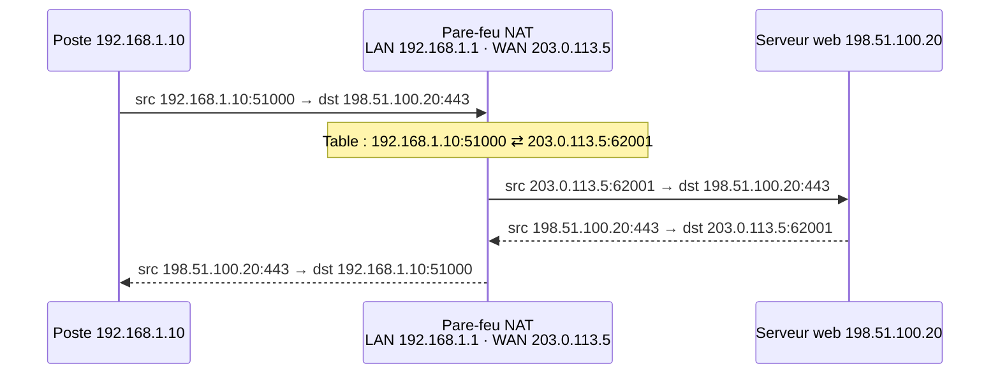
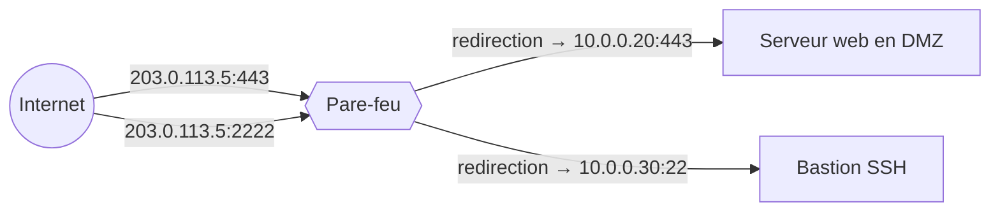

[← Chapitre précédent](02-Matrices-de-flux-et-regles.md) · [Sommaire](Readme.md) · [Chapitre suivant →](04-Inspection-IDS-IPS.md)

# Le NAT — Network Address Translation

## 🎯 Objectifs du chapitre

- Comprendre pourquoi le NAT existe
- Suivre la traduction d'adresses d'un paquet
- Distinguer NAT statique, NAT dynamique, PAT et DNAT

---

## 1. Définition

Le **NAT** permet à plusieurs équipements d'accéder à Internet en partageant
une seule adresse IP publique — ou un petit nombre d'entre elles. Il est
devenu indispensable parce que les adresses IPv4 publiques sont limitées,
alors que le nombre d'appareils connectés ne cesse de croître.

Le NAT a aussi un effet de sécurité : il **masque les adresses privées** du
réseau local, ce qui rend plus difficile pour un attaquant de localiser et de
viser ces machines.

---

## 2. Fonctionnement

Le routeur ou le pare-feu réécrit l'adresse source des paquets sortants, et
garde la trace de chaque connexion dans une **table de traduction**, pour
réécrire en sens inverse les réponses.

Le serveur web ne voit jamais l'adresse `192.168.1.10` : il ne connaît que
l'adresse publique du pare-feu.

---

## 3. Les types de NAT

| Type | Correspondance | Usage |
|---|---|---|
| **NAT statique** | une adresse privée ⇄ une adresse publique, de façon permanente (« un à un ») | serveurs qui doivent être joignables avec leur propre adresse publique |
| **NAT dynamique** | plusieurs adresses privées ⇄ un *pool* d'adresses publiques, attribuées à la demande | partage d'un pool d'adresses publiques |
| **PAT** (*Port Address Translation*, ou NAT avec surcharge) | plusieurs adresses privées ⇄ **une** adresse publique, distinguées par le **port** | le cas le plus courant : la box d'un particulier, la sortie Internet d'une entreprise |
| **DNAT** (*Destination NAT*, redirection de port) | un port de l'adresse publique ⇄ une adresse privée et un port | rendre joignable depuis Internet un serveur placé derrière le pare-feu |

### Le PAT

Chaque connexion sortante reçoit un couple *adresse publique : port* unique ;
c'est le port qui permet de renvoyer la réponse au bon équipement. Le
diagramme du paragraphe précédent en est un exemple.

### Le DNAT

---

## ✅ Vérifier ses acquis

1. Pourquoi le NAT est-il devenu indispensable en IPv4 ?
2. Vingt postes partagent une seule adresse publique. Comment le pare-feu sait-il à qui renvoyer chaque réponse ?
3. Quel type de NAT faut-il pour publier un serveur web interne sur Internet ?

Voir la correction

1. Les adresses IPv4 publiques sont en nombre limité, bien inférieur au nombre d'équipements connectés.
2. Par le port : le PAT attribue à chaque connexion un port source unique sur l'adresse publique, consigné dans la table de traduction.
3. Du DNAT (redirection de port), ou un NAT statique si le serveur dispose de sa propre adresse publique.

---

[← Chapitre précédent](02-Matrices-de-flux-et-regles.md) · [Sommaire](Readme.md) · [Chapitre suivant →](04-Inspection-IDS-IPS.md)
