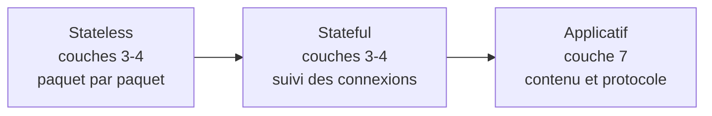
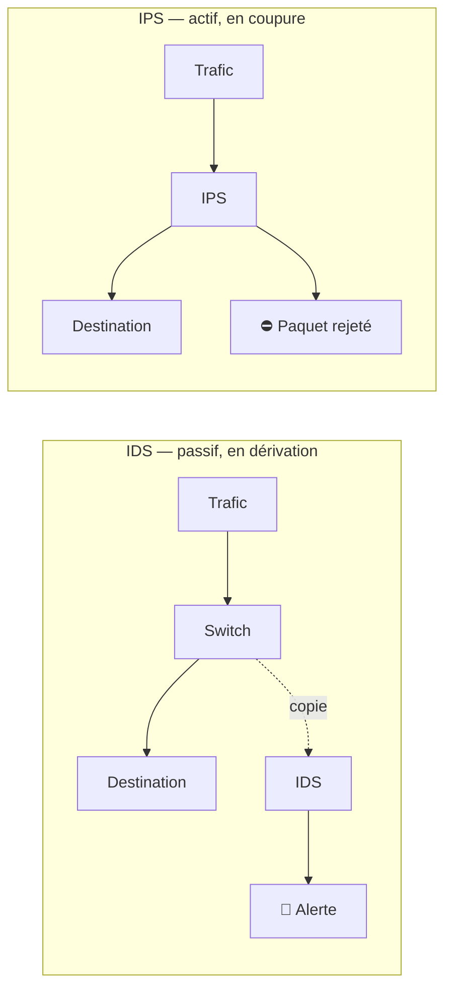

[← Chapitre précédent](03-NAT.md) · [Sommaire](Readme.md) · [Chapitre suivant →](05-Proxy.md)

# Inspection : stateless, stateful, applicatif, IDS, IPS

## 🎯 Objectifs du chapitre

- Distinguer les pare-feu sans état, à état et applicatifs
- Comprendre le rôle des IDS et des IPS, et leurs variantes réseau et hôte

---

## 1. Les niveaux d'inspection

### Pare-feu sans état — *stateless packet inspection*

- fonctionne sur les **couches 3 et 4** du modèle OSI ;
- inspecte **chaque paquet individuellement**, sans mémoire des précédents ;
- filtre à l'aide de **listes de contrôle d'accès** (ACL) : IP source, port source, IP de destination, port de destination ;
- applique l'action prévue par l'ACL : autoriser ou bloquer.

Ce type de pare-feu tend à disparaître au profit des pare-feu à état. On le
trouve encore sur certains routeurs et systèmes d'exploitation.

### Pare-feu à état — *stateful packet inspection*

- fonctionne aussi sur les **couches 3 et 4** ;
- inspecte les en-têtes des paquets qui composent une connexion TCP ou UDP ;
- vérifie que chaque paquet est bien la **suite** du précédent dans sa connexion ;
- garde une trace des sessions et réagit en cas d'anomalie ;
- filtre par ACL **et** suit l'état des connexions, ce qui lui permet d'adapter dynamiquement ses règles — par exemple, laisser passer automatiquement la réponse à une requête autorisée.

### Pare-feu applicatif

Pare-feu de dernière génération :

- filtre **par application**, en couche 7 du modèle OSI ;
- vérifie la **conformité des protocoles** utilisés (un flux sur le port 443 est-il vraiment du HTTPS ?) ;
- permet l'inspection applicative et l'ouverture dynamique de ports.

| | Stateless | Stateful | Applicatif |
|---|---|---|---|
| Couches OSI | 3-4 | 3-4 | 3 à 7 |
| Mémoire des connexions | non | oui | oui |
| Voit le contenu | non | non | oui |
| Coût en ressources | faible | moyen | élevé |

---

## 2. IDS et IPS

Ces systèmes sont aujourd'hui généralement **intégrés aux pare-feu**, pour
former un **UTM** (*Unified Threat Management*, gestion unifiée des menaces).
Ils analysent l'en-tête **et le contenu** des paquets, et s'appuient sur des
bases de signatures d'attaques connues, qui doivent être constamment mises à
jour.

### IDS — Intrusion Detection System

L'IDS **surveille** : il compare le trafic à une base d'attaques connues pour
détecter les comportements contraires à la politique de sécurité — malwares,
scans de ports… C'est une solution **passive** : il alerte, et un humain doit
intervenir.

### IPS — Intrusion Prevention System

L'IPS **bloque** : il analyse lui aussi le trafic, mais rejette
automatiquement les paquets qui représentent une menace. C'est une solution
**active**, qui agit sans intervention humaine.

### Réseau ou hôte

| | Surveille | IDS | IPS |
|---|---|---|---|
| **Réseau** | le trafic d'un segment réseau | NIDS | NIPS |
| **Hôte** | les fichiers système d'une machine et leurs modifications | HIDS | HIPS |

> 💡 Snort et Suricata sont deux moteurs IDS/IPS open source très répandus ;
> Wazuh est un exemple de HIDS.

---

## ✅ Vérifier ses acquis

1. Qu'apporte un pare-feu à état par rapport à un pare-feu sans état ?
2. Quelle est la différence fondamentale entre un IDS et un IPS ?
3. Que surveille un HIDS ?

Voir la correction

1. Il suit l'état des connexions : il sait si un paquet appartient à une connexion légitime, et adapte ses règles en conséquence.
2. L'IDS détecte et alerte (passif) ; l'IPS bloque automatiquement (actif).
3. Les fichiers système d'une machine et leurs modifications.

---

[← Chapitre précédent](03-NAT.md) · [Sommaire](Readme.md) · [Chapitre suivant →](05-Proxy.md)
