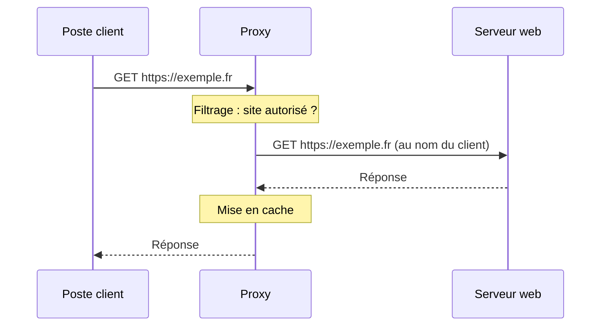
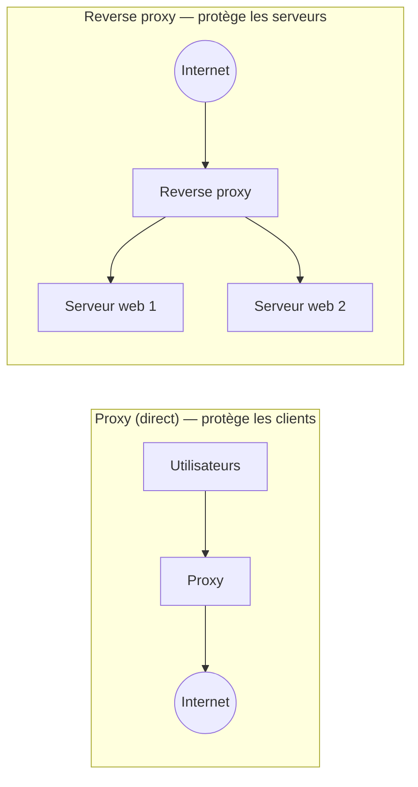
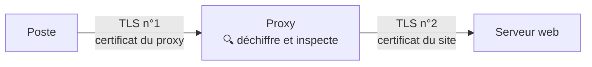

[← Chapitre précédent](04-Inspection-IDS-IPS.md) · [Sommaire](Readme.md) · [Chapitre suivant →](06-VPN.md)

# Le proxy

Un **proxy** est un équipement réseau — boîtier physique, machine virtuelle
ou logiciel installé sur un serveur — qui se connecte **à notre place** à une
autre machine, un serveur web par exemple.

## 🎯 Objectifs du chapitre

- Comprendre les rôles d'un proxy
- Distinguer les principaux types de proxy
- Comprendre le principe de l'inspection SSL
- Connaître les modes de filtrage

---

## 1. Les rôles du proxy

- **Intermédiaire** entre le réseau local et Internet : il retransmet les requêtes web ;
- **Filtrage** des accès aux sites ;
- **Cache** du contenu consulté, pour accélérer la navigation et économiser la bande passante ;
- **Masquage** de l'adresse IP des clients : seuls apparaissent ceux du proxy.

---

## 2. Les principaux types de proxy

| Type | Principe |
|---|---|
| **Explicite** | Configuré dans les paramètres proxy du navigateur ou du poste ; les requêtes HTTP/HTTPS lui sont adressées, il les relaie vers les serveurs web |
| **Transparent** | Placé sur le chemin réseau entre les postes et Internet : tout le trafic le traverse, sans configuration côté poste. L'utilisateur ne sait pas qu'il passe par un proxy — et ne peut donc pas le contourner en le désactivant |
| **Anonyme** | Remplace l'adresse IP de l'utilisateur par la sienne : le serveur web voit le proxy, pas le client. Il ne chiffre pas la connexion : ce n'est pas un VPN |
| **Cache** | Garde en mémoire les éléments déjà consultés : s'il les a, il les sert directement ; sinon, il va les chercher et les enregistre |
| **Reverse proxy** | Placé **devant les serveurs web de l'entreprise**, côté Internet : mise en cache, répartition de charge, sécurisation des accès aux services web |

---

## 3. Le cas du trafic HTTPS

Pour filtrer la navigation, le proxy analyse les requêtes HTTP. Mais en
HTTPS, requêtes et réponses sont **chiffrées de bout en bout** par TLS
(successeur de SSL) : le proxy ne voit plus que le nom du site, pas le
contenu.

La solution s'appelle l'**inspection SSL** (*SSL/TLS interception*). Elle
reprend le principe de l'attaque de l'**homme du milieu** (*man in the
middle*) — se placer entre le client et le serveur pour lire ce qui transite —
mais de façon assumée et maîtrisée :

1. l'entreprise déploie sur tous ses postes le **certificat** de son proxy, qui devient une autorité de confiance ;
2. le proxy établit une connexion chiffrée avec le poste, en se présentant avec ce certificat ;
3. il établit une seconde connexion chiffrée avec le vrai serveur ;
4. entre les deux, il déchiffre, inspecte et filtre.

> ⚠️ L'inspection SSL donne accès à des données sensibles (banque, santé…) :
> elle s'encadre juridiquement — information des salariés, exclusion de
> certaines catégories de sites.

---

## 4. Le filtrage

Une fois le proxy en place, on peut observer en temps réel les requêtes
HTTP/HTTPS et poser des règles :

- **liste blanche** (*whitelist*) : les seuls sites autorisés ;
- **liste noire** (*blacklist*) : les sites interdits.

Les offres de proxy en **SaaS** fournissent des **catégories** de sites
tenues à jour (réseaux sociaux, jeux, sites malveillants…) : une solution de
filtrage clé en main. On peut créer des exceptions, et autoriser ou refuser
des catégories selon les groupes d'utilisateurs.

---

## ✅ Vérifier ses acquis

1. Pourquoi un proxy transparent est-il plus difficile à contourner qu'un proxy explicite ?
2. Quelle est la différence entre un proxy et un reverse proxy ?
3. Pourquoi l'inspection SSL nécessite-t-elle de déployer un certificat sur les postes ?

Voir la correction

1. Il n'est pas configuré sur le poste : l'utilisateur ne peut pas le désactiver, tout le trafic le traverse.
2. Le proxy se place devant les clients et relaie leurs requêtes vers Internet ; le reverse proxy se place devant les serveurs de l'entreprise et reçoit les requêtes venues d'Internet.
3. Pour que les postes fassent confiance au proxy lorsqu'il se présente à la place du site : sans ce certificat, le navigateur afficherait une alerte de sécurité.

---

[← Chapitre précédent](04-Inspection-IDS-IPS.md) · [Sommaire](Readme.md) · [Chapitre suivant →](06-VPN.md)
