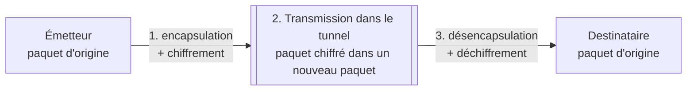
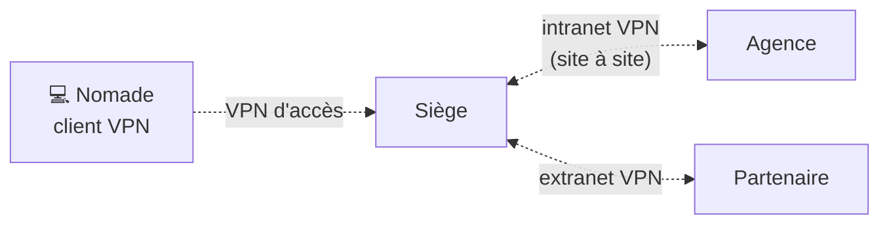

[← Chapitre précédent](05-Proxy.md) · [Sommaire](Readme.md)

# Le VPN — Virtual Private Network

Un **VPN** (réseau privé virtuel) est un **tunnel chiffré** qui relie un ou
plusieurs sites distants sans que d'autres équipements puissent intercepter
le trafic entre eux.

## 🎯 Objectifs du chapitre

- Comprendre le principe du tunneling
- Distinguer les usages d'un VPN : accès distant, intranet, extranet
- Connaître les fonctions qu'un VPN doit assurer
- Comparer les principaux protocoles VPN

---

## 1. Principe de fonctionnement

Un VPN repose sur un **protocole de tunneling** : les données de l'entreprise
circulent chiffrées d'un bout à l'autre du tunnel, et les utilisateurs ont
l'impression d'être connectés directement au réseau de l'entreprise.

Le tunneling construit un **chemin virtuel** entre l'émetteur et le
destinataire. L'émetteur chiffre les données et les achemine par ce chemin,
qui emprunte en réalité une infrastructure partagée comme Internet. C'est
une forme d'**encapsulation**, en trois temps :

---

## 2. Les usages d'un VPN

| Usage | Principe |
|---|---|
| **VPN d'accès** (*remote access*) | permet à un utilisateur nomade d'accéder au réseau privé depuis une connexion Internet, soit par un **logiciel client VPN** installé sur son poste, soit par une connexion chiffrée fournie par son FAI |
| **Intranet VPN** (*site à site*) | relie entre eux deux intranets — ou plus — d'une même entreprise |
| **Extranet VPN** | même principe, pour relier l'entreprise à des clients ou des partenaires |

---

## 3. Ce qu'un VPN doit assurer

- l'**authentification** des utilisateurs ;
- l'**historique** des connexions et de l'activité ;
- la **gestion des adresses IP**, de manière confidentielle ;
- le **chiffrement** des données pendant leur transport ;
- la **gestion des clés** de chiffrement ;
- la prise en charge des protocoles usuels, en particulier IP.

---

## 4. Les protocoles VPN

### Protocoles de niveau 2

| Protocole | Description |
|---|---|
| **PPTP** — *Point-to-Point Tunneling Protocol* | Tunnel s'appuyant sur une connexion PPP, avec authentification par identifiant et mot de passe. Simple, sans matériel supplémentaire, mais son chiffrement est **cassé** : à proscrire aujourd'hui |
| **L2F** — *Layer 2 Forwarding* | Protocole propriétaire Cisco, quasiment disparu |
| **L2TP** — *Layer 2 Tunneling Protocol* | Issu de la convergence de PPTP et L2F (Microsoft et Cisco). Il forme un tunnel entre deux concentrateurs L2TP, mais **ne chiffre pas** : on l'associe à IPsec (L2TP/IPsec) |

### Protocoles de niveau 3 et au-delà

| Protocole | Description |
|---|---|
| **IPsec** — *Internet Protocol Security* | Sécurise les échanges au niveau de la couche réseau, par deux mécanismes : **AH** (*Authentication Header*), qui garantit l'intégrité et l'authenticité des datagrammes, et **ESP** (*Encapsulating Security Payload*), qui chiffre les données. Standard des VPN site à site |
| **MPLS** — *Multiprotocol Label Switching* | Des tunnels sont créés entre les routeurs de périphérie de l'opérateur, dédiés à des groupes fermés d'usagers : chaque groupe forme un VPN. Il cloisonne sans chiffrer |
| **OpenVPN** — VPN SSL/TLS | Protocole et logiciel open source qui sécurisent les données avec SSL/TLS. Demande un client et une configuration, mais offre une sécurité élevée |
| **WireGuard** | Protocole récent, intégré au noyau Linux : code réduit, cryptographie moderne, performances élevées |

> 💡 Pour un nouveau déploiement : IPsec (IKEv2) ou WireGuard en site à site,
> OpenVPN ou WireGuard pour les nomades. PPTP n'a plus sa place nulle part.

---

## ✅ Vérifier ses acquis

1. Que signifie « encapsulation » dans le contexte d'un VPN ?
2. Pourquoi L2TP est-il presque toujours associé à IPsec ?
3. Quels sont les deux mécanismes d'IPsec, et que garantit chacun ?

Voir la correction

1. Le paquet d'origine est chiffré puis placé à l'intérieur d'un nouveau paquet, qui traverse le réseau public ; à l'arrivée, il est extrait et déchiffré.
2. L2TP construit le tunnel mais ne chiffre pas : IPsec apporte le chiffrement.
3. AH garantit l'intégrité et l'authenticité des datagrammes ; ESP en chiffre le contenu.

---

[← Chapitre précédent](05-Proxy.md) · [Sommaire](Readme.md)
