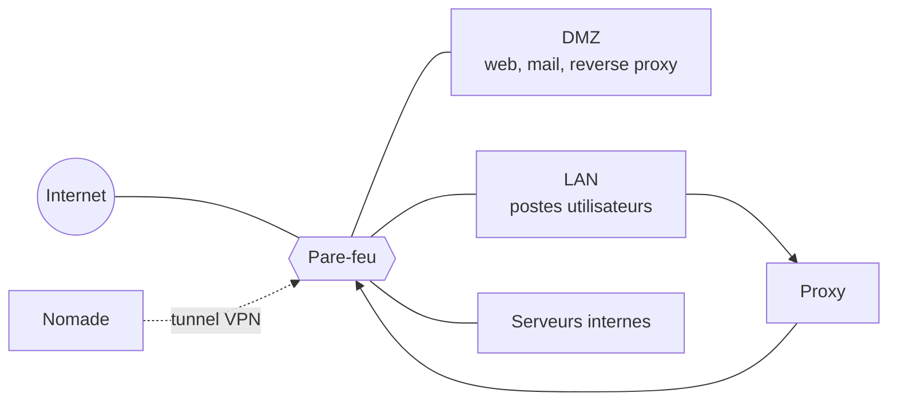

  <picture>
    <source media="(prefers-color-scheme: dark)" srcset="assets/Logo-diginamic-color-blk.png">
    
  </picture>

# Pare-feu, proxy et VPN

Les équipements qui gardent les frontières d'un réseau : le pare-feu qui
filtre, traduit et cloisonne, le proxy qui sert d'intermédiaire vers le web,
et le VPN qui relie des sites ou des utilisateurs distants à travers un tunnel
chiffré.

**Auteur :** Nicolas SAHUC <sahuc.nic@gmail.com>

## 🎯 Objectifs pédagogiques

À la fin de ce cours, vous saurez :

1. Définir un pare-feu, en distinguer les types et citer les principaux constructeurs.
2. Découper un réseau en zones de sécurité et justifier la place d'une DMZ.
3. Construire une matrice de flux et en déduire des règles de filtrage.
4. Expliquer le NAT et ses variantes : statique, dynamique, PAT, DNAT.
5. Distinguer les pare-feu sans état, à état et applicatifs, ainsi que les IDS et les IPS.
6. Présenter les types de proxy et le principe de l'inspection SSL.
7. Expliquer le fonctionnement d'un VPN et comparer ses principaux protocoles.

## ❔ Pourquoi ce cours ?

Un réseau d'entreprise est exposé en permanence : à Internet, aux
partenaires, aux postes nomades. Pare-feu, proxy et VPN sont les trois outils
qui permettent d'ouvrir ce qui doit l'être, et seulement cela. Savoir les
configurer commence par savoir exprimer ce qu'on veut autoriser.

## Le parcours

| # | Étape | Durée | Ce qu'on y fait |
|---|---|---|---|
| [01](01-Le-pare-feu.md) | Le pare-feu | 1 h | définition, types de pare-feu, constructeurs, zones et DMZ |
| [02](02-Matrices-de-flux-et-regles.md) | Matrices de flux et règles de filtrage | 1 h 30 | exprimer une politique de flux, critères et types de règles |
| [03](03-NAT.md) | Le NAT | 1 h | traduction d'adresses, NAT statique et dynamique, PAT, DNAT |
| [04](04-Inspection-IDS-IPS.md) | Inspection : stateless, stateful, applicatif, IDS, IPS | 1 h | niveaux d'inspection, détection et prévention d'intrusion |
| [05](05-Proxy.md) | Le proxy | 1 h | types de proxy, trafic HTTPS et inspection SSL, filtrage |
| [06](06-VPN.md) | Le VPN | 1 h 30 | tunneling, usages, caractéristiques, protocoles de niveau 2 et 3 |
